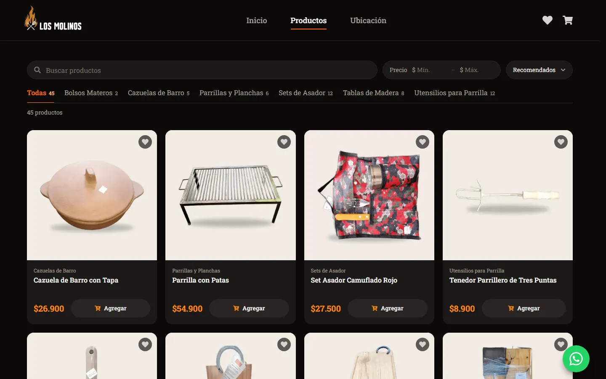
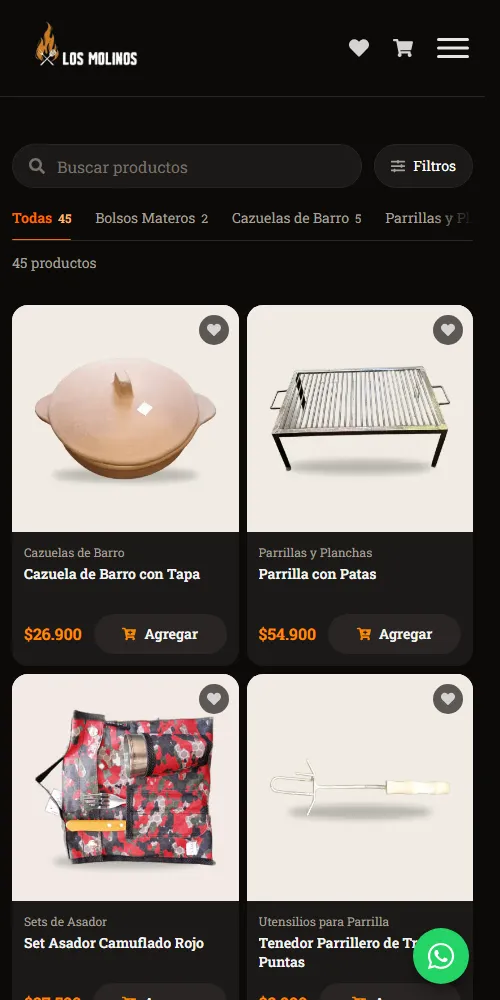
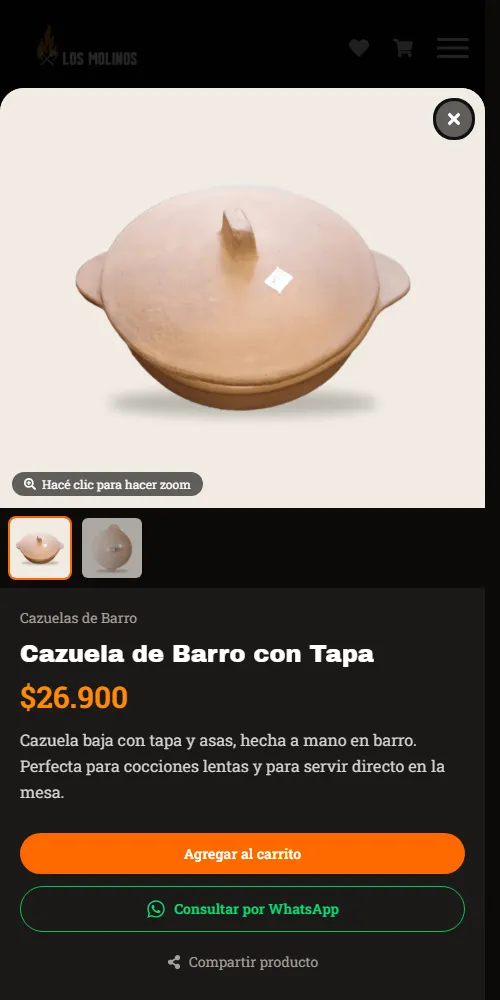

# Los Molinos Regionales — Tienda online

Código fuente de **[lmregionales.vercel.app](https://lmregionales.vercel.app)**, la tienda online de un negocio de accesorios para parrilla de Dolores, Buenos Aires. Digitaliza un catálogo tradicional con una experiencia de compra moderna, pensada sobre todo para celular.

Es una **SPA en React** con **Tailwind CSS**, con el catálogo en **Firestore**, publicado como un archivo estático en cada build, y cierra cada venta con un **pedido armado automáticamente por WhatsApp**: el canal donde el negocio ya atiende a sus clientes.



<p align="center">
  
  
</p>

## ✨ Funcionalidades

**Catálogo y stock**
- Productos, precios y stock cargados desde Firestore; el negocio los actualiza sin tocar código.
- En cada build el catálogo se genera como `catalog.json`: los visitantes no leen Firestore, así el plan gratuito no se agota con el tráfico ni con abusos.
- Stock simple de disponible / sin stock: los productos agotados se muestran en gris, con la etiqueta "Sin stock", y van al final.
- El carrito se re-sincroniza con el catálogo al abrirlo: actualiza precios y quita los productos sin stock o dados de baja.

**Detalle de producto**
- Cada producto tiene su propia URL (`/productos/:id`) que abre un detalle sobre el catálogo, sin perder la posición del scroll.
- Zoom que sigue al cursor en PC, y visor a pantalla completa con pellizco, doble toque y arrastre en celular.
- Botón para consultar por WhatsApp con el producto ya mencionado, y para compartirlo (menú nativo en celular, copia del link en PC).

**Compra**
- Carrito y favoritos persistidos en el navegador; el carrito muestra un contador en el header y se sincroniza entre pestañas.
- Checkout por WhatsApp: el mensaje se arma con el detalle del pedido y el total.
- Botón flotante de WhatsApp en todo el sitio, información de horarios, medios de pago y zona de entrega.

**Panel de administración (`/admin`)**
- Login con Google; solo entran las cuentas con un documento `admins/{uid}` en Firestore.
- Crear, editar y borrar productos, cambiar el stock con un toque y subir fotos a Cloudinary con subida firmada.
- "Publicar cambios" dispara un build en Cloudflare Pages que regenera el catálogo; el panel avisa si hay cambios sin publicar.
- Las reglas de Firestore validan cada producto y no dejan leer la base al público.

**Rendimiento y SEO**
- Rutas con carga diferida: la tienda no descarga Firebase y la página de inicio no carga las animaciones (bundle inicial ~80 KB gzip).
- Imágenes servidas por Cloudinary en WebP/AVIF, con tamaños responsive y carga diferida.
- Metadatos Open Graph para la vista previa al compartir y datos estructurados de negocio local (`schema.org/Store`) para búsquedas en Google.

## 🛠️ Stack

| | |
|---|---|
| UI | React 19, React Router 7, Tailwind CSS 4 |
| Datos | Firebase Firestore |
| Imágenes | Cloudinary |
| Extras | lottie-react (animaciones), react-zoom-pan-pinch (zoom táctil), react-icons |
| Build y deploy | Vite, Cloudflare Pages |

## 📁 Estructura

```
src/
├── components/   Header, footer, detalle de producto, visor de imágenes, botones reutilizables
├── admin/      Panel de administración (se descarga solo al entrar a /admin)
├── context/      Estado global del carrito (CartProvider + useCart)
├── hooks/        useDocumentTitle
├── pages/        Productos/Favoritos, Carrito, Ubicación, 404
├── services/     Lectura del catálogo (catalog.json)
└── utils/        Precios, stock, imágenes, WhatsApp y datos del negocio
scripts/
└── build-catalog.mjs   Genera catalog.json desde Firestore en cada build
functions/api/          Funciones de Cloudflare que usa solo el panel: firma de fotos y publicación
server/admin.js         Lógica compartida por esas funciones y el servidor de desarrollo
firestore.rules         Reglas de la base (se publican con firebase deploy --only firestore:rules)
```

## 🚀 Correr el proyecto

Requiere Node.js 24.

```bash
npm install
npm run catalog   # genera public/catalog.json (hace falta para npm run dev)
npm run dev       # servidor de desarrollo
npm run build     # build de producción en dist/, con el catálogo incluido
npm run lint
```

La app usa el proyecto de Firestore del negocio. Para conectarla a uno propio, reemplazá la configuración en `src/firebaseConfig.js` y creá una colección `products` con documentos de esta forma:

```js
{
  name: "Set Asador con Estuche de Cuero",
  category: "Sets de Asador",
  price: 28500,          // número, en pesos
  inStock: true,         // booleano; si falta, el producto se considera disponible
  imageUrl: "https://res.cloudinary.com/...",
  description: "Utensilios de calidad para la parrilla..."
}
```

Las variables de entorno están documentadas en `.env.example`: van en `.env.local` para desarrollo y como variables del proyecto en Cloudflare Pages. El build lee Firestore con una cuenta lectora (`CATALOG_READER_EMAIL` y `CATALOG_READER_PASSWORD`). Sin ellas, intenta leer sin login, lo que solo funciona si las reglas dejan leer `products` a cualquiera.

> La configuración de Firebase del frontend es pública por diseño: la base de datos está protegida por las reglas de `firestore.rules`.

---

Hecho por Antonino Joaquín — **[LinkedIn](https://www.linkedin.com/in/antoninojoaquin/)**.
